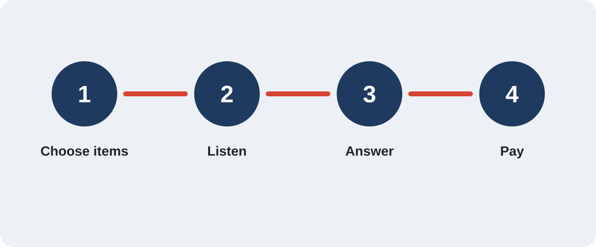

## What happens at checkout

This demonstration article shows the page structure, not a verified store visit. In a real guide, the measured prices and photographs should come from an actual stop at a chain store on a normal daily route.

1. Put your items on the counter or in the checkout area.
2. Listen for a question about a bag, heating, or utensils.
3. Answer with a short phrase, or show the phrase card below.
4. Pay using a method accepted at that register.

## Why these questions matter

The register exchange is quick, and staff may not speak English. Knowing the likely question makes it easier to choose an answer without relying on a translation app in the moment.

## A simple first-visit tip

If you are unsure what was asked, a polite smile and a clear point at the relevant item can help. The exact options may vary, so treat this as a preparation guide rather than a promise about every branch.
